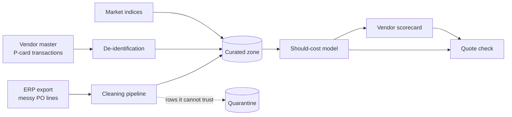

# Strategic Sourcing & Negotiation Copilot

A reference implementation of a copilot that tells a buyer what a part *should*
cost, flags overpriced quotes, and prepares the negotiation. It starts from the
messy data a procurement team really has and ends with a number a buyer can
defend in front of a vendor.

> All data in this repository is synthetic. The company, vendors, prices,
> contracts and market indices are generated by the code in `src/copilot/datagen`.

```text
$ python -m copilot.quote_check --material MAT-0001 --qty 5000 --price 1.62 --vendor V-0001 --date 2025-06-15

Quote check: MAT-0001 (steel_sheet), 5,000 kg on 2025-06-15
  Quoted price        1.6200 USD per kg
  Should-cost         1.4000  (range 1.3026 to 1.4665)
  Gap vs should-cost  +15.7%  (flag above +12%)
  Verdict             OVERPRICED
  Potential saving    1,100.14 USD if negotiated to should-cost
  Market (steel_hrc)  -8.2% in 3 months, -2.5% in 12 months
  Vendor              Asia Tech Co., Ltd.: score 84.1 (rank 32 of 80), on time 86%, usually priced +1.7% vs should-cost
```

## The problem

A procurement team at a mid-sized manufacturer buys raw materials and parts
from hundreds of vendors. Before every sourcing event, buyers face the same
five problems:

1. **Slow preparation.** Purchase history, quotes, market prices, contracts
   and vendor performance live in different systems. Pulling them together
   takes two to three days per event.
2. **No view of the fair price.** Buyers compare a quote with the last price
   paid. When steel or resin prices fall, vendors rarely pass it on in full,
   and nobody notices.
3. **Unused contract rights.** Volume rebates and price-adjustment clauses sit
   in long PDF contracts that nobody opens before a negotiation.
4. **Results depend on the individual.** Senior buyers get better prices, but
   their know-how is not written down and there is nowhere to practise.
5. **Scattered, sensitive data.** Spend data is inconsistent across systems,
   and vendor records hold bank accounts and card numbers, so they cannot be
   handed to an AI system as they are.

## What is in this repository today

| Step | What it does | Code |
| --- | --- | --- |
| 1. Messy source data | Generates an ERP export with the problems real spend data has: the same vendor spelled six ways, mixed units (kg / ton / g) and currencies (THB / USD / EUR), four date formats including Thai Buddhist-era years, duplicates, blanks and decimal slips | `src/copilot/datagen` |
| 2. Cleaning pipeline | Resolves vendor names to a master record, standardises units and currency, parses dates, and moves rows it cannot trust to a quarantine file with a reason | `src/copilot/pipeline/clean.py` |
| 3. De-identification | Tokenises tax IDs, bank accounts and card numbers and masks emails before data reaches the curated zone | `src/copilot/pipeline/deidentify.py` |
| 4. Should-cost model | Estimates a fair price range (p10 / p50 / p90) from commodity index, labour cost and volume, and compares it with the rule of thumb buyers use today | `src/copilot/model/should_cost.py` |
| 5. Vendor scorecard | Scores every vendor on delivery, quality, price and risk in SQL | `sql/vendor_score.sql` |
| 6. Quote check | Takes one quote and returns the verdict, the saving at stake, the market trend and the vendor's record | `src/copilot/quote_check.py` |

The multi-agent chat layer and the Google Cloud deployment are the next two
stages. See [Roadmap](#roadmap).

## Results so far

Measured by running `make all` on the synthetic dataset (seed 42). Models are
trained on 2021 to 2024 and tested on 2025, which they never saw. The full
output is in [`reports/`](reports).

**Data cleaning** (61,200 raw purchase-order lines)

| Outcome | Rows |
| --- | --- |
| Exact duplicates removed | 1,200 |
| Quarantined: missing quantity or price | 562 |
| Quarantined: negative quantity (returns) | 282 |
| Quarantined: price outlier (decimal slip) | 154 |
| Quarantined: vendor could not be identified | 118 |
| Clean rows kept | 58,884 |

Checked against the generator's ground truth, every kept row was matched to
the correct vendor, with quantity and price recovered to within 0.1%.

**Should-cost accuracy** (11,710 held-out purchase lines from 2025)

| Method | Mean absolute % error |
| --- | --- |
| Rule of thumb: last price paid, adjusted by the index change | 7.2% |
| Gradient-boosted trees (p50) | 4.8% |
| Cost formula per material | 4.5% |

75.6% of actual prices fell inside the p10 to p90 range, against a nominal
80%, so the range is slightly too narrow.

**Overpriced-quote detection** (2,695 held-out quotes from 2025, 399 truly overpriced)

| Metric | Value |
| --- | --- |
| Precision | 93.9% |
| Recall | 92.2% |

A quote is flagged when it is more than 12% above should-cost. That cut-off was
tuned on quotes from before 2025.

These numbers describe synthetic data whose prices follow a known cost
formula. Real spend is noisier and results will be lower.

## Quickstart

Requires Python 3.11 or newer. No cloud account is needed for this stage.

```bash
git clone https://github.com/thimabhornK/sourcing-negotiation-copilot.git
cd sourcing-negotiation-copilot
python -m venv .venv && source .venv/bin/activate
make install

make all          # generate data, clean it, train the model, score vendors (about 30 seconds)
make check-quote  # check an example quote
make test         # run the test suite
```

Check your own quote:

```bash
python -m copilot.quote_check --material MAT-0012 --qty 2000 --price 85 --currency THB --vendor V-0007
```

Add `--json` to get the same result as structured data.

A 40-row sample of the messy input is in
[`data/sample/erp_po_lines_sample.csv`](data/sample/erp_po_lines_sample.csv)
if you want to see it before running anything.

## How it works



Design choices worth knowing:

- **Bad rows are quarantined, not dropped.** Each rejected row keeps its
  original values and a reason, so someone can review it.
- **The should-cost model does not know who the vendor is.** It estimates what
  the material should cost, so a vendor's own high prices cannot become its
  own benchmark.
- **Time-based split.** Training on a random sample would let the model see
  future prices and report an accuracy it cannot reach in use.
- **Two models with different strengths.** The cost formula gives the mid
  estimate because it keeps following the market index outside the range seen
  in training, which tree models cannot do. The boosted model supplies the
  width of the range.
- **Numbers come from code, not from a language model.** The quote check is
  deterministic, so the same quote always gets the same answer.

A longer explanation of each step is in [`docs/walkthrough.md`](docs/walkthrough.md).

## Repository layout

```
src/copilot/datagen/    Synthetic data generator and the mess it injects
src/copilot/pipeline/   Cleaning and de-identification
src/copilot/model/      Should-cost training and evaluation
src/copilot/scoring/    Vendor scorecard
src/copilot/quote_check.py
sql/                    SQL used by the scorecard
tests/                  Unit and end-to-end tests
reports/                Output of the latest full run
data/sample/            Small sample of the raw input
docs/                   Walkthrough
```

## Adapting it to your own data

1. Export purchase-order lines with the columns in
   `data/sample/erp_po_lines_sample.csv` and place the file at
   `data/raw/erp_po_lines.csv`.
2. Provide your vendor and material masters in the same folder, and a monthly
   file of the commodity indices that drive your categories.
3. Set `COPILOT_DEID_KEY` to a secret value before running the pipeline.
4. Start with one category, run `make clean-data train`, and read
   `reports/data_quality.json` before trusting any model output.

Check your company's data policy before loading real spend data.

## Roadmap

- [x] Messy data generator, cleaning pipeline, de-identification
- [x] Should-cost model, vendor scorecard, quote check
- [ ] Contract retrieval with clause and page citations
- [ ] Multi-agent chat: Ask, Check a quote, Negotiate (playbook, draft email, vendor simulator)
- [ ] Evaluation harness for the agents: answer quality, latency, cost per request
- [ ] Google Cloud deployment: BigQuery and BigLake lakehouse, PySpark on Dataproc Serverless, Sensitive Data Protection, Spanner, Vertex AI, Agent Development Kit

## Limitations

- Prices in the synthetic data follow a known formula, so the accuracy figures
  are an upper bound on what to expect from real spend.
- Market indices are simulated, not real commodity prices.
- The de-identification here is keyed hashing for local use. It is a stand-in
  for a managed service, not a compliance control.
- The should-cost model covers commodity-driven materials. Services and one-off
  purchases need a different approach.

## License

Apache-2.0
