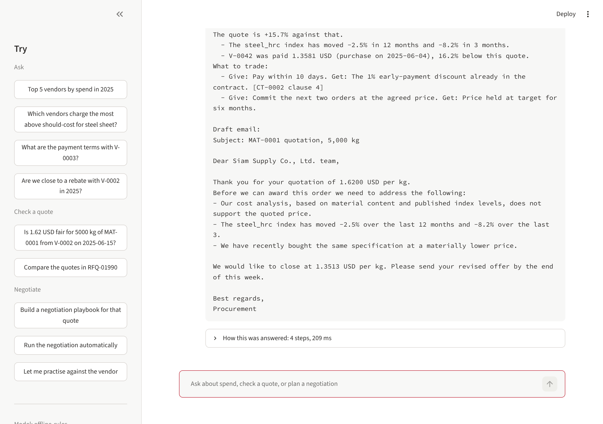
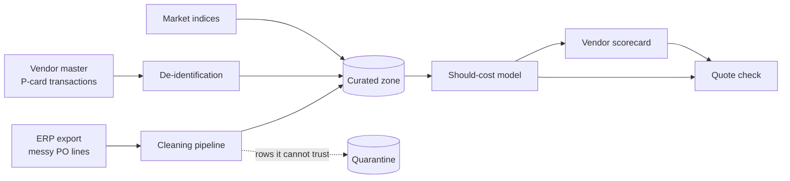
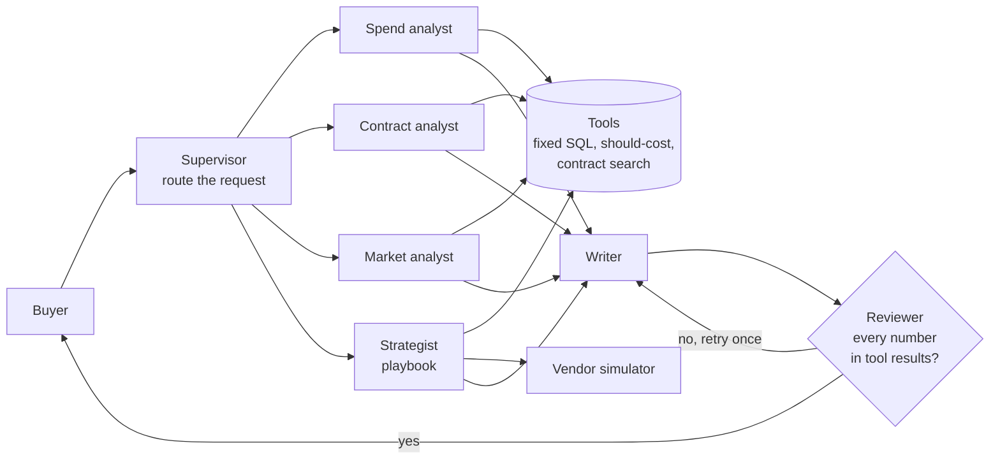

# Strategic Sourcing & Negotiation Copilot

A reference implementation of a copilot that tells a buyer what a part *should*
cost, flags overpriced quotes, and prepares the negotiation. It starts from the
messy data a procurement team really has and ends with a number a buyer can
defend in front of a vendor.

> All data in this repository is synthetic. The company, vendors, prices,
> contracts and market indices are generated by the code in `src/copilot/datagen`.

```text
> Is 1.62 USD fair for 5000 kg of MAT-0001 from V-0002 on 2025-06-15?

Quote check: MAT-0001 (steel_sheet), 5,000 kg on 2025-06-15
  Quoted price        1.6200 USD per kg
  Should-cost         1.4000  (range 1.3026 to 1.4665)
  Gap vs should-cost  +15.7%  (flag above +12%)
  Verdict             OVERPRICED
  Market (steel_hrc)  -8.2% in 3 months, -2.5% in 12 months

> Build a negotiation playbook for that

Negotiation playbook: Siam Supply Co., Ltd., MAT-0001, 5,000 kg
  Open at       1.3513 USD
  Target        1.4000 USD (saves 1,100.00 USD on this order)
  Walk away at  1.5680 USD
Arguments to use:
  - Our cost model puts this material at 1.4000 USD per kg (range 1.3026 to 1.4665). The quote is +15.7% against that.
  - The steel_hrc index has moved -2.5% in 12 months and -8.2% in 3 months.
What to trade:
  - Give: Pay within 10 days. Get: The 1% early-payment discount already in the contract. [CT-0002 clause 4]
```

(Output shortened. The full answer also lists recent purchases, alternatives
and a draft email to the vendor.)

## The problem

A procurement team at a mid-sized manufacturer buys raw materials and parts
from hundreds of vendors. Before every sourcing event, buyers face the same
five problems:

1. **Slow preparation.** Purchase history, quotes, market prices, contracts
   and vendor performance live in different systems. Pulling them together
   takes two to three days per event.
2. **No view of the fair price.** Buyers compare a quote with the last price
   paid. When steel or resin prices fall, vendors rarely pass it on in full,
   and nobody notices.
3. **Unused contract rights.** Volume rebates and price-adjustment clauses sit
   in long PDF contracts that nobody opens before a negotiation.
4. **Results depend on the individual.** Senior buyers get better prices, but
   their know-how is not written down and there is nowhere to practise.
5. **Scattered, sensitive data.** Spend data is inconsistent across systems,
   and vendor records hold bank accounts and card numbers, so they cannot be
   handed to an AI system as they are.

## What is in this repository today

| Step | What it does | Code |
| --- | --- | --- |
| 1. Messy source data | Generates an ERP export with the problems real spend data has: the same vendor spelled six ways, mixed units (kg / ton / g) and currencies (THB / USD / EUR), four date formats including Thai Buddhist-era years, duplicates, blanks and decimal slips | `src/copilot/datagen` |
| 2. Cleaning pipeline | Resolves vendor names to a master record, standardises units and currency, parses dates, and moves rows it cannot trust to a quarantine file with a reason | `src/copilot/pipeline/clean.py` |
| 3. De-identification | Tokenises tax IDs, bank accounts and card numbers and masks emails before data reaches the curated zone | `src/copilot/pipeline/deidentify.py` |
| 4. Should-cost model | Estimates a fair price range (p10 / p50 / p90) from commodity index, labour cost and volume, and compares it with the rule of thumb buyers use today | `src/copilot/model/should_cost.py` |
| 5. Vendor scorecard | Scores every vendor on delivery, quality, price and risk in SQL | `sql/vendor_score.sql` |
| 6. Quote check | Takes one quote and returns the verdict, the saving at stake, the market trend and the vendor's record | `src/copilot/quote_check.py` |
| 7. Contract search | Splits 80 supply agreements into clauses, finds the clause that answers a question and cites it, and extracts payment, rebate, penalty and termination terms | `src/copilot/contracts` |
| 8. Negotiation playbook | Combines the price check, contract rights, rebate position and alternatives into an opening ask, a target, a walk-away price, arguments and a draft email | `src/copilot/negotiation/playbook.py` |
| 9. Vendor simulator | A rule-based vendor with a hidden price limit, for rehearsing a negotiation and for comparing strategies | `src/copilot/negotiation/simulator.py` |
| 10. Agent team and chat | A supervisor routes each message to specialist agents that call tools; a reviewer checks every number in the answer against the tool results. Runs in a terminal or a browser | `src/copilot/agents`, `src/copilot/chat.py`, `app/` |
| 11. Agent evaluation and tracing | Scores routing, retrieval, extraction, the reviewer and negotiation strategies; records latency, tokens and cost per step | `src/copilot/eval`, `src/copilot/agents/tracing.py` |

The chat has three modes:

- **Ask**: spend, vendor performance and contract questions.
- **Check a quote**: is this price fair, and how do the quotes in a sourcing event compare.
- **Negotiate**: get a playbook, rehearse against the simulated vendor, or let two strategies play out automatically.



The Google Cloud deployment is the next stage. See [Roadmap](#roadmap).

## Results so far

Measured by running `make all` on the synthetic dataset (seed 42). Models are
trained on 2021 to 2024 and tested on 2025, which they never saw. The full
output is in [`reports/`](reports).

**Data cleaning** (61,200 raw purchase-order lines)

| Outcome | Rows |
| --- | --- |
| Exact duplicates removed | 1,200 |
| Quarantined: missing quantity or price | 562 |
| Quarantined: negative quantity (returns) | 282 |
| Quarantined: price outlier (decimal slip) | 154 |
| Quarantined: vendor could not be identified | 118 |
| Clean rows kept | 58,884 |

Checked against the generator's ground truth, every kept row was matched to
the correct vendor, with quantity and price recovered to within 0.1%.

**Should-cost accuracy** (11,710 held-out purchase lines from 2025)

| Method | Mean absolute % error |
| --- | --- |
| Rule of thumb: last price paid, adjusted by the index change | 7.2% |
| Gradient-boosted trees (p50) | 4.8% |
| Cost formula per material | 4.5% |

75.6% of actual prices fell inside the p10 to p90 range, against a nominal
80%, so the range is slightly too narrow.

**Overpriced-quote detection** (2,695 held-out quotes from 2025, 399 truly overpriced)

| Metric | Value |
| --- | --- |
| Precision | 93.9% |
| Recall | 92.2% |

A quote is flagged when it is more than 12% above should-cost. That cut-off was
tuned on quotes from before 2025.

These numbers describe synthetic data whose prices follow a known cost
formula. Real spend is noisier and results will be lower.

**Agent layer** (`make eval`, written to [`reports/agent_eval.json`](reports/agent_eval.json))

| What is measured | Result |
| --- | --- |
| Routing rules on 42 hand-written messages | 95.2% correct (the two misses are listed in the report) |
| Contract retrieval, right clause ranked first, 480 questions in buyer wording | 49.6% with plain TF-IDF, 88.1% after mapping buyer vocabulary to contract vocabulary |
| Contract term extraction, 480 fields across 80 contracts | 100% |
| Reviewer: answers with one figure deliberately altered that were caught | 93% of 100, with no false alarms on 100 correct answers |
| Median response time per turn, without a language model | under 0.1 second |

The retrieval misses are questions that share no words with the clause
("Do we get anything for paying faster?"). That is the limit of keyword
retrieval and the reason the cloud version uses embeddings. Extraction scores
100% because the synthetic contracts use a small set of clause templates.

**Negotiation strategies against the simulated vendor** (400 held-out quotes from 2025, negotiated one-to-one)

| Quotes | Asking for 5% off, no evidence | Following the playbook | Gap to the vendor's normal price |
| --- | --- | --- | --- |
| 200 overpriced | 5.0% saved | 18.7% saved | 19.2% |
| 200 fairly priced | 1.4% saved | 2.4% saved | 1.5% |

Read this table with care. The simulated vendor follows fixed rules and
concedes more when the buyer presents evidence that is true, so a strategy
that brings evidence is expected to win. What the table shows is that the
playbook sizes its ask to the real gap: it recovers most of a markup that a
flat 5% request leaves in place, and does not over-ask on a fair quote. It is
not a forecast of savings with real vendors.

**Not yet measured.** Two parts need credentials and have not been run yet,
so there are no figures for them here:

- The Gemini path (routing and wording by a language model). `make eval-live`
  measures it and writes `reports/agent_eval_live.json`.
- The BigQuery serving layer. `make bq-parity` runs it and writes
  `reports/bigquery_parity.json`.

Both are implemented, their SQL and fallbacks are covered by tests, and the
steps to run them are in [Running on Google Cloud](#running-on-google-cloud).

## Quickstart

Requires Python 3.11 or newer. No cloud account or API key is needed.

```bash
git clone https://github.com/thimabhornK/sourcing-negotiation-copilot.git
cd sourcing-negotiation-copilot
python -m venv .venv && source .venv/bin/activate
make install

make all          # generate data, clean it, train the model, score vendors (about 30 seconds)
make check-quote  # check an example quote
make chat         # talk to the copilot in the terminal
make eval         # score the agent layer (about 90 seconds)
make test         # run the test suite
```

Things to type in the chat:

```text
Top 5 vendors by spend in 2025
Which vendors charge the most above should-cost for steel sheet?
What happens if V-0002 delivers late?
Are we close to a rebate with V-0002 in 2025?
Is 1.62 USD fair for 5000 kg of MAT-0001 from V-0002 on 2025-06-15?
Build a negotiation playbook for that
Let me practise against the vendor
```

`python -m copilot.chat --trace` also prints each agent step with its timing.

For the browser version:

```bash
pip install -e ".[app]"
make app
```

**With or without a language model.** With no API key the chat runs on rules
and templates, which is what the tests and the evaluation use. To let Gemini
route messages and word the answers:

```bash
pip install -e ".[agents]"
export GEMINI_API_KEY=your-key
export COPILOT_GEMINI_MODEL=gemini-2.5-flash   # optional
make chat
```

Tools still produce every number, and the reviewer rejects an answer that
contains a figure the tools did not return. The same agents are declared for
the Agent Development Kit in `src/copilot/agents/adk_app.py` (`adk web adk`).

Check your own quote:

```bash
python -m copilot.quote_check --material MAT-0012 --qty 2000 --price 85 --currency THB --vendor V-0007
```

Add `--json` to get the same result as structured data.

A 40-row sample of the messy input is in
[`data/sample/erp_po_lines_sample.csv`](data/sample/erp_po_lines_sample.csv)
and one generated contract is in
[`data/sample/contract_sample.md`](data/sample/contract_sample.md)
if you want to see them before running anything.

## Running on Google Cloud

Neither step needs a billing account. The BigQuery sandbox and the Gemini API
free tier are enough for this dataset.

**BigQuery.** The scorecard and the spend queries have a BigQuery version in
[`sql/bigquery`](sql/bigquery).

```bash
pip install -e ".[cloud]"
gcloud auth application-default login
export COPILOT_BQ_PROJECT=your-project-id

make bq-load      # upload five tables with load jobs
make bq-parity    # run each query on BigQuery and on DuckDB, and compare the results
```

`make bq-parity` reports, per query, whether both engines return the same rows
in the same order, the largest numeric difference, the bytes scanned and the
time taken. To make the chat use BigQuery for spend questions:

```bash
COPILOT_BACKEND=bigquery make chat
```

The sandbox has no DML and its tables expire after 60 days, so the loader
replaces whole tables and `make bq-load` can simply be run again.

**Gemini.**

```bash
pip install -e ".[agents]"
export GEMINI_API_KEY=your-key
make eval-live    # about 10 minutes on a free key; add --limit to shorten
```

This compares the model router with the rules on the same 42 messages, then
runs 16 conversation turns and records how often the model's wording passed
the number check first time, needed a retry or was replaced by the template
answer, whether contract citations and price verdicts survived the rewording,
and the tokens, cost and latency per turn.

On the free tier Google may use prompts to improve its products. That is
acceptable for this synthetic dataset and not for real spend data.

## How it works



The agent layer sits on top of those outputs:



Design choices worth knowing:

- **The language model never produces a number.** Agents get figures only
  from tools. Spend questions run through fixed, parameterised SQL and not
  model-written SQL. The reviewer compares each number in the answer with the
  tool results, sends a failed answer back once, and then falls back to a
  template answer.
- **It works without a model.** Routing and wording have rule-based
  fallbacks, so an outage or a quota error degrades the wording and not the
  facts.
- **The email to the vendor says less than the playbook.** The internal plan
  names competitors and the exact cost estimate. The draft email does not.
- **A past price is not an alternative.** Only a live competing quote sets
  the walk-away price. A price paid to another vendor last month is used as an
  argument only.

- **Bad rows are quarantined, not dropped.** Each rejected row keeps its
  original values and a reason, so someone can review it.
- **The should-cost model does not know who the vendor is.** It estimates what
  the material should cost, so a vendor's own high prices cannot become its
  own benchmark.
- **Time-based split.** Training on a random sample would let the model see
  future prices and report an accuracy it cannot reach in use.
- **Two models with different strengths.** The cost formula gives the mid
  estimate because it keeps following the market index outside the range seen
  in training, which tree models cannot do. The boosted model supplies the
  width of the range.
- **One query, two engines, checked against each other.** DuckDB runs the
  queries locally and in the tests; BigQuery runs them in the cloud. The
  parity check exists because the two dialects differ in ways that change
  results quietly, such as how a median is computed.
- **Numbers come from code, not from a language model.** The quote check is
  deterministic, so the same quote always gets the same answer.

A longer explanation of each step is in [`docs/walkthrough.md`](docs/walkthrough.md).

## Repository layout

```
src/copilot/datagen/    Synthetic data generator and the mess it injects
src/copilot/pipeline/   Cleaning and de-identification
src/copilot/model/      Should-cost training and evaluation
src/copilot/scoring/    Vendor scorecard
src/copilot/quote_check.py
src/copilot/contracts/  Clause search and term extraction
src/copilot/tools.py    The functions agents are allowed to call
src/copilot/negotiation/ Playbook and vendor simulator
src/copilot/agents/     Supervisor, writer, reviewer, tracing, model boundary, ADK definitions
src/copilot/eval/       Agent evaluation, offline (run.py) and with a live model (live.py)
src/copilot/cloud/      BigQuery loader, query runner and parity check
src/copilot/chat.py     Terminal chat
app/                    Browser chat (Streamlit)
adk/                    Entry point for the ADK developer UI
sql/                    Scorecard SQL for DuckDB; sql/bigquery holds the BigQuery versions
tests/                  Unit and end-to-end tests
reports/                Output of the latest full run
data/sample/            Small sample of the raw input
docs/                   Walkthrough
```

## Adapting it to your own data

1. Export purchase-order lines with the columns in
   `data/sample/erp_po_lines_sample.csv` and place the file at
   `data/raw/erp_po_lines.csv`.
2. Provide your vendor and material masters in the same folder, and a monthly
   file of the commodity indices that drive your categories.
3. Set `COPILOT_DEID_KEY` to a secret value before running the pipeline.
4. Start with one category, run `make clean-data train`, and read
   `reports/data_quality.json` before trusting any model output.

Check your company's data policy before loading real spend data.

## Roadmap

- [x] Messy data generator, cleaning pipeline, de-identification
- [x] Should-cost model, vendor scorecard, quote check
- [x] Contract retrieval with clause citations and term extraction
- [x] Multi-agent chat: Ask, Check a quote, Negotiate (playbook, draft email, vendor simulator)
- [x] Evaluation harness for the agents and per-step tracing
- [x] BigQuery serving layer with a parity check against the local engine
- [x] Live-model evaluation harness: routing, answer checks, tokens, cost and latency with Gemini
- [ ] Publish the measured BigQuery and Gemini results
- [ ] Google Cloud deployment: BigQuery and BigLake lakehouse, PySpark on Dataproc Serverless, Sensitive Data Protection, Spanner, Vertex AI, Agent Development Kit

## Limitations

- Prices in the synthetic data follow a known formula, so the accuracy figures
  are an upper bound on what to expect from real spend.
- Market indices are simulated, not real commodity prices.
- The de-identification here is keyed hashing for local use. It is a stand-in
  for a managed service, not a compliance control.
- Contract retrieval is keyword-based and the contracts come from a small set
  of templates. Real contracts need embeddings, a document parser and review
  of extracted terms.
- The vendor simulator follows fixed rules. Use it to rehearse and to compare
  strategies, not to predict a real vendor.
- The offline router is a list of patterns. It handles the phrasings in the
  evaluation set and will miss others; that is the job of the model router.
- The should-cost model covers commodity-driven materials. Services and one-off
  purchases need a different approach.

## License

Apache-2.0
